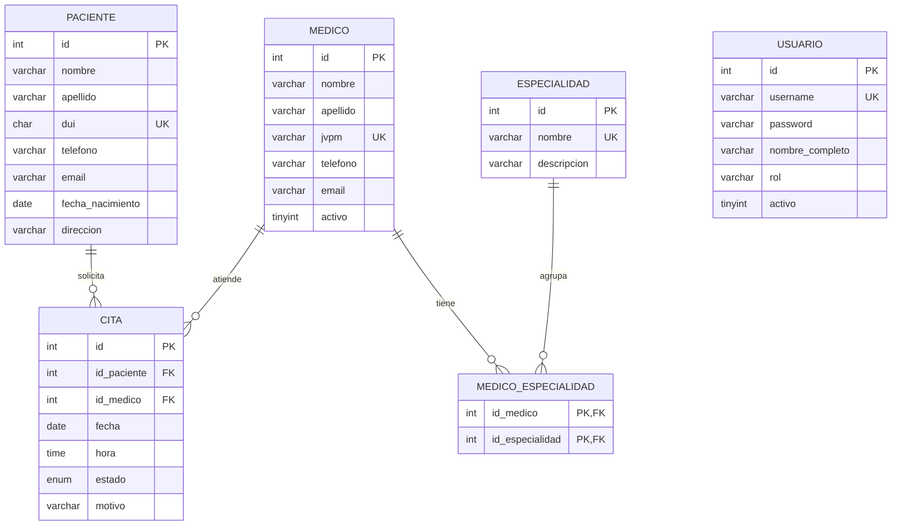

# Diseño de la base de datos

## Diagrama ER



(Si el visor no renderiza mermaid, se puede pegar el bloque en https://mermaid.live y exportar la imagen para el documento.)

Versión simple en texto:

```
PACIENTE 1 ----< CITA >---- 1 MEDICO 1 ----< MEDICO_ESPECIALIDAD >---- 1 ESPECIALIDAD
USUARIO (tabla aparte, solo para el login)
```

## Justificación del diseño

**Tablas.** Son 6: usuario, especialidad, paciente, medico, medico_especialidad y cita. Usuario va separada porque solo sirve para entrar al sistema y no tiene relación con las demás.

**Médico y especialidad (N:M).** Un médico puede tener varias especialidades y una especialidad la tienen varios médicos. Por eso no se pone una columna `especialidad` en medico: se usa la tabla intermedia `medico_especialidad` con llave primaria compuesta (id_medico, id_especialidad), que además evita repetir el mismo par.

**Cita.** Es la tabla que une paciente y médico (relación 1:N con cada uno) y guarda fecha, hora, estado y motivo. El estado es un ENUM (PENDIENTE, CONFIRMADA, ATENDIDA, CANCELADA) para que no se guarden valores raros. Tiene un UNIQUE (id_medico, fecha, hora) para que la base misma impida dos citas del mismo médico a la misma hora, aparte de la validación que se haga en Java.

**Llaves foráneas y borrado.**
- Borrar un médico borra sus filas de medico_especialidad (CASCADE), porque esas filas no tienen sentido sin él.
- No se puede borrar una especialidad si algún médico la usa, ni un paciente o médico con citas (RESTRICT). Así no se pierde historial. El sistema avisa con un mensaje en vez de dar error.

**Campos únicos.** DUI del paciente, JVPM del médico, username y nombre de especialidad son UNIQUE para no tener duplicados.

**Contraseñas.** Se guardan con SHA-256 en vez de texto plano. En el script se insertan con `SHA2('clave', 256)` y en Java se compara con la misma función (clase `Hash`).

**Charset.** utf8mb4 para que funcionen tildes y la ñ.

## Usuarios de prueba

| usuario | contraseña |
|---|---|
| admin | admin123 |
| recepcion | recep123 |
